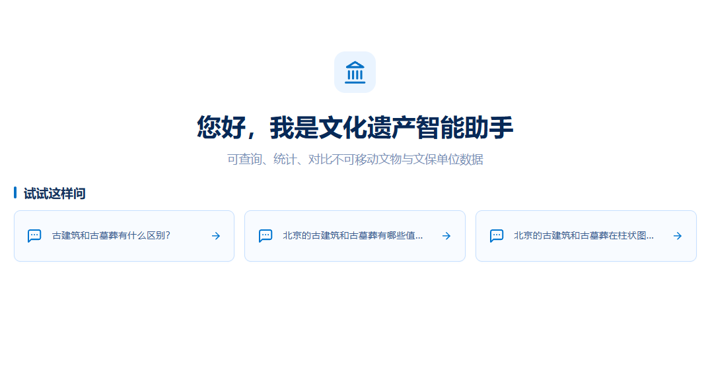
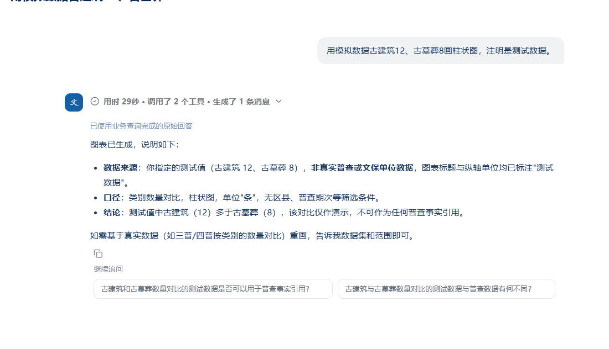

# dsh-recommendation

[English](README.md) | 简体中文

一个面向 [DeepSeek Harness](https://github.com/deepseek-ai/deepseek-harness) 和 Cordis 的隐私友好型个性化问题推荐服务。

它会在受控范围内记录近期行为，通过 OpenAI 兼容模型提取语义兴趣，并生成主页推荐问题和回答后的继续追问。插件本身不回答用户问题、不调用业务工具、不暴露 HTTP 接口，也不依赖特定 MCP 服务。

## 效果展示

### 主页个性化推荐



### 回答后的继续追问



## 功能特性

- 生成主页推荐问题和与当前轮次相关的继续追问。
- 区分用户直接输入和点击推荐问题产生的行为证据。
- 维护近期兴趣和长期兴趣，支持兴趣衰减及跨会话确认阈值。
- 支持隐藏单个问题及抑制相似语义兴趣。
- 按工作区使用 JSON 持久化，并通过原子替换发布数据。
- 通过 `forgetSessions()` 协调会话删除和推荐数据清理。
- 支持 Cordis 安全卸载：停止排队任务、中止正在执行的模型请求，并防止旧任务继续写入画像或缓存。
- 支持 OpenAI 兼容接口及可选 Bearer Token 认证。
- 提供 `entity`、`location`、`topic`、`category`、`concept` 和 `other` 六类通用兴趣类型。

## 环境要求

- Node.js 22 或更高版本。
- `@deepseek-ai/cordis` 4.x。
- 用于生成推荐问题的 OpenAI 兼容 `/v1/chat/completions` 接口。模型不可用时，服务会降级返回配置的兜底问题。

## 安装

```bash
npm install dsh-recommendation @deepseek-ai/cordis
```

在 npm 正式发布前，可以直接从 GitHub 安装：

```bash
npm install github:wlhcloud/dsh-recommendation
```

## 注册到 Cordis

```ts
import { Context } from '@deepseek-ai/cordis'
import RecommendationService from 'dsh-recommendation'

const ctx = new Context()

await ctx.plugin(RecommendationService, {
  baseUrl: 'http://127.0.0.1:11434/v1',
  recommendModel: 'qwen3:4b',
  interestModel: 'qwen3:4b',
  language: 'zh-CN',
}).await()

const recommendations = ctx.get('recommendations')
```

宿主应用应当在完成用户认证后，向插件提供该用户独占的工作区路径。插件不会根据工作区路径自行推断授权关系。

```ts
await recommendations.record(
  '/srv/app/workspaces/user-42',
  'session-7',
  'request-19',
  '乐观锁是如何工作的？',
  'user_input',
)

const home = await recommendations.home('/srv/app/workspaces/user-42')

const followUp = await recommendations.followUps(
  '/srv/app/workspaces/user-42',
  'session-7',
  3,
  '乐观锁是如何工作的？',
  '乐观锁通过比较版本字段来识别并发写入。',
)
```

`record()` 会等待近期事件完成持久化，并把语义兴趣提取任务加入队列，但不会等待模型提取完成。只有维护流程或测试确实需要等待队列清空时，才应调用 `waitForExtraction(workspace)`。

## 配置

构造参数的优先级高于环境变量。

| 构造参数 | 环境变量 | 默认值 |
| --- | --- | --- |
| `baseUrl` | `DSH_RECOMMENDATION_OPENAI_BASE_URL` | `http://127.0.0.1:11434/v1` |
| `apiKey` | `DSH_RECOMMENDATION_OPENAI_API_KEY` | 未设置 |
| `recommendModel` | `DSH_RECOMMENDATION_MODEL` | `qwen3:4b` |
| `interestModel` | `DSH_RECOMMENDATION_INTEREST_MODEL` | 与推荐模型相同 |
| `language` | `DSH_RECOMMENDATION_LANGUAGE` | `zh-CN` |
| `homeFallback` | `DSH_RECOMMENDATION_HOME_FALLBACK` | 4 个通用问题 |
| `interestPrompt` | 仅构造参数 | 内置通用提示词 |
| `recommendationPrompt` | 仅构造参数 | 内置通用提示词 |

`DSH_RECOMMENDATION_HOME_FALLBACK` 使用竖线 `|` 分隔多个问题。自定义提示词必须保持文档约定的 JSON 输出结构；模型返回格式无效时，插件会安全降级。

## 服务 API

| 方法 | 用途 |
| --- | --- |
| `record(workspace, sessionId, requestId, query, source?)` | 保存近期事件并排队执行兴趣提取 |
| `home(workspace)` | 生成最多 4 个主页推荐问题 |
| `followUps(workspace, sessionId, turn, question, answer)` | 根据已完成问答生成最多 3 个继续追问 |
| `dismissQuestion(workspace, question)` | 持久化隐藏某个问题及其近似问题 |
| `suppress(workspace, interest, until?)` | 抑制某个语义兴趣 |
| `waitForExtraction(workspace)` | 等待指定工作区当前的兴趣提取任务链结束 |
| `forgetSessions(workspace, sessionIds)` | 关闭会话、等待相关任务结束并删除对应行为证据 |

插件提供名为 `recommendations` 的 Cordis 服务。HTTP 路由、用户认证、工作区归属、界面渲染和用户授权均由宿主应用负责。

## 数据与隐私

画像保存在：

```text
<workspace>/.dsh-recommendation/profile.json
```

画像包括数量受限的近期问题、派生兴趣、偏好设置、兴趣抑制项和已隐藏问题。它不能被用作用户身份、访问权限或已经核实的事实依据。

配置的模型会接收经过限制的当前问题与回答、会话上下文以及筛选后的兴趣。部署方应说明该数据处理行为、保护工作区权限、提供删除入口，并避免在缺少适当数据协议时向外部模型接口发送敏感内容。

插件不包含遥测功能。

## 宿主接入建议

- 先完成用户认证，再解析该用户拥有的工作区。
- 推荐失败不能影响主聊天流程。
- 保留 `await record(...)` 语义，以保证方法返回前近期事件已经成功发布。
- 在宿主的会话删除流程中调用 `forgetSessions()`。
- 如果宿主支持 Cordis 服务热注册或撤销，应当动态获取服务实例。
- 不要让多个写进程同时操作同一画像目录；当前原子性边界是单进程协调加文件系统重命名。

取消、卸载及持久化保证详见 [LIFECYCLE.md](LIFECYCLE.md)。

## 开发

```bash
npm install
npm run check
```

测试使用临时目录和模拟模型响应，无需启动真实模型，也不会写入生产画像。

## 许可证

[MIT](LICENSE)
